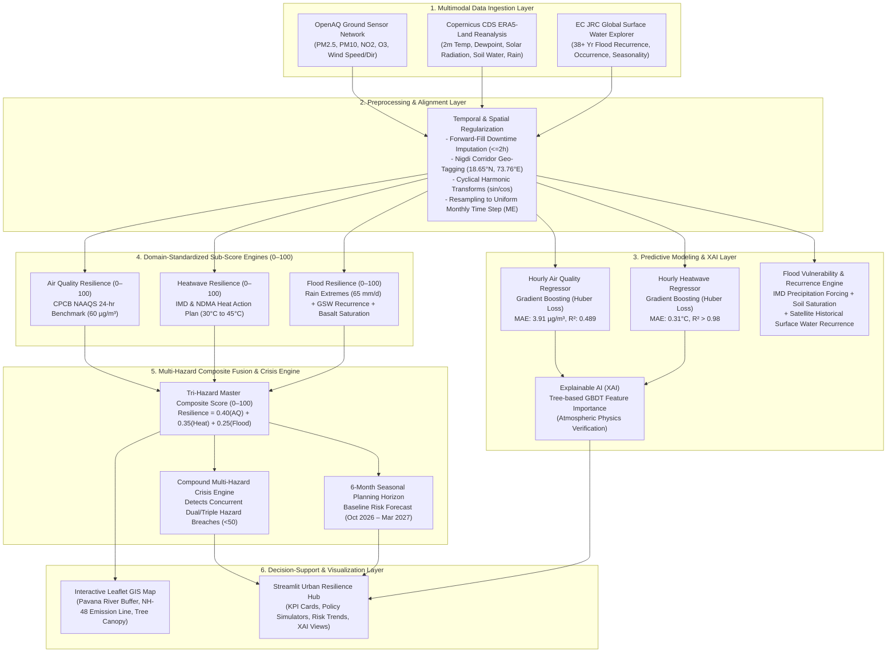

# System Architecture: AI-Based Urban Climate Resilience Intelligence System

This document outlines the end-to-end system architecture of the **AI-Based Urban Climate Resilience Intelligence System** developed for the **PCMC Nigdi Corridor (`18.65°N, 73.76°E`), Pune, Maharashtra, India**.

---

## 🏗️ High-Level System Architecture Overview

The system is organized into a modular 6-tier architecture designed for continuous multimodal ingestion, physical feature regularization, robust machine learning regression, multi-criteria GeoAI hydrological modeling, scientific score fusion, and interactive decision support.



---

## 🧩 Architectural Tiers in Detail

### Tier 1: Multimodal Environmental Ingestion Layer
Ingests diverse environmental and climatic data streams across varying formats, frequencies, and physical spatial resolutions:
- **OpenAQ Ground IoT Stations (`extract_openaq.py` / `openAQ_dataset.ipynb`)**:
  - Pulls continuous hourly atmospheric observations from official regulatory air quality stations covering the Nigdi–Ravet corridor.
  - Parameters: $\text{PM}_{2.5}$, $\text{PM}_{10}$, $\text{NO}_2$, $\text{O}_3$, wind speed, and wind direction.
- **Copernicus Climate Data Store (CDS) ERA5-Land Reanalysis (`extract_cds_heatwave.py`)**:
  - Ingests $0.1^\circ \times 0.1^\circ$ (~9 km) hourly meteorological and land-surface reanalysis data.
  - Parameters: 2-meter air temperature ($T_{2m}$), dewpoint temperature ($T_d$), total precipitation ($tp$), surface net solar radiation ($ssrd$), and topsoil layer 1 volumetric water content ($swvl1$, 0–7 cm depth).
- **EC JRC Global Surface Water (GSW) Explorer (`extract_gsw_flood.py`)**:
  - Ingests 38+ years of high-resolution historical Landsat satellite records (Tile `70E_20N`).
  - Parameters: Historical surface water recurrence percentage, inundation seasonality, and persistent water presence along the Pavana River basin.

---

### Tier 2: Preprocessing, Harmonic Transforms & Alignment Layer
Ensures mathematical consistency, temporal synchronization, and leakage prevention:
- **Spatial Alignment**: Geographically clips and re-projects all environmental metrics to the target PCMC Nigdi grid bounding box centered at `18.65°N, 73.76°E`.
- **Temporal Alignment (`step2_align_monthly.py`)**: Resamples continuous hourly sensor streams into a standardized monthly calendar frequency (`ME` / Month End), aligning 20 uninterrupted consecutive months (February 2025 to September 2026).
- **Leak-Free Lag Engineering**: Creates autoregressive temporal lags $[1, 2, 3, 6, 12, 24]$ hours and rolling statistics ($\text{mean}_3, \text{mean}_6, \text{mean}_{24}$). To prevent lookahead target leakage, all rolling windows are strictly shifted by 1 time step (`shift(1)`).
- **Cyclical Harmonic Encodings**: Transforms non-linear cyclical features (24-hour day cycle and 360° meteorological wind directions) into continuous 2D Cartesian coordinates using trigonometric sine and cosine functions:
  $$\text{hour}_{\sin} = \sin\left(\frac{2\pi \cdot \text{hour}}{24}\right), \quad \text{hour}_{\cos} = \cos\left(\frac{2\pi \cdot \text{hour}}{24}\right)$$
  $$\text{wind}_{\sin} = \sin(\theta_{\text{rad}}), \quad \text{wind}_{\cos} = \cos(\theta_{\text{rad}})$$

---

### Tier 3: Predictive Modeling & GeoAI Inundation Layer
Deploys specialized models tailored to the temporal dynamics of each hazard:
1. **Continuous Hazard Regressors (`step3_heatwave_modeling.py`, `AQ_score_hourly.ipynb`)**:
   - Supervised **Gradient Boosting Decision Trees (GBDT)** utilizing scikit-learn's `GradientBoostingRegressor`.
   - **Huber Loss Criterion**: Combines $L_2$ squared-error efficiency for standard residuals with robust $L_1$ absolute-error resistance against sudden industrial particulate spikes or localized heat bursts.
   - **Validation Protocol**: Strict chronological 80/20 train-test temporal split (8,549 training hours vs. 2,138 test hours) without data leakage.
2. **GeoAI Hydrological Inundation Model (`step4_flood_vulnerability_pipeline.py`)**:
   - Addresses the severe $>99.5\%$ annual class imbalance inherent in monsoon flash flooding.
   - Synthesizes IMD daily extreme rainfall thresholds ($65\,\text{mm/day}$), Deccan basalt soil field capacity ($0.42\,\text{m}^3/\text{m}^3$), and JRC 38-year satellite recurrence into a multi-criteria hydrological vulnerability engine.
3. **Model Explainability Engine (`step6_multihazard_fusion_explainability.py`)**:
   - Computes feature importances across trained ensemble pipelines, confirming alignment with atmospheric boundary layer physics.

---

### Tier 4: Standardized Resilience Sub-Score Engines (0–100)
Normalizes disparate physical units ($\mu\text{g/m}^3$, ${}^\circ\text{C}$, $\text{mm/day}$) into intuitive, domain-grounded resilience scores where **$100$ represents optimal climate resilience** and **$0$ represents critical crisis**:
- **Air Quality Resilience Engine (`step5_aq_resilience_scoreboard.py`)**: Benchmark against Indian CPCB 24-hr NAAQS standard ($60\,\mu\text{g/m}^3$).
- **Heatwave Resilience Engine (`step5_heatwave_resilience_scoreboard.py`)**: Benchmark against IMD/NDMA Heat Action Plan thresholds ($30^\circ\text{C}$ to $45^\circ\text{C}$).
- **Flood Resilience Engine (`step4_flood_vulnerability_pipeline.py`)**: Multi-criteria penalty engine accounting for surface runoff, field capacity saturation, and satellite inundation recurrence.

---

### Tier 5: Multi-Hazard Composite Fusion & Crisis Engine
Integrates individual sub-scores into an executive composite resilience index:
- **Tri-Hazard Composite Formulation (`step6_multihazard_fusion_explainability.py`)**:
  $$\text{Resilience}_{\text{Composite}} = (0.40 \times \text{Score}_{\text{AQ}}) + (0.35 \times \text{Score}_{\text{Heat}}) + (0.25 \times \text{Score}_{\text{Flood}})$$
- **Compound Crisis Engine**: Continuously monitors whether two or more sub-scores simultaneously drop below the emergency threshold ($<50$), triggering automatic escalation protocols.
- **6-Month Seasonal Planning Horizon**: Projects a risk baseline for municipal resource mobilization (October 2026 to March 2027) based on seasonal historical trends.

---

### Tier 6: Geospatial & Decision-Support Visualization Hub
Delivers actionable environmental intelligence to urban planners, municipal administrators, and citizens:
- **Leaflet.js Spatial Map (`step7_nigdi_spatial_map.py` / `nigdi_climate_vulnerability_map.html`)**:
  - Standalone, zero-dependency interactive geospatial map centered at PCMC Nigdi (`18.65°N, 73.76°E`).
  - Features real-time score-coded pins, Pavana riverbank flood buffer zones, NH-48 vehicular emission corridors, and Pradhikaran green canopy polygons.
- **Streamlit Intelligence Dashboard (`app_urban_resilience_dashboard.py`)**:
  - Executive KPI metric tiles with dynamic delta badges.
  - Interactive "What-If" Policy Simulator allowing users to model the impact of municipal interventions (e.g., $+25\%$ tree canopy, road misting, drain desilting).
  - High-resolution Matplotlib trend plots and feature importance breakdowns.

---

## 🔄 End-to-End Execution & Data Pipeline

```text
[extract_openaq.py]   --> Nigdi_OpenAQ_Hourly_Model_Ready.csv ──┐
[extract_cds_heatwave.py]--> Nigdi_CDS_Heatwave_Monthly.csv     ├──> [step2_align_monthly.py]
[extract_gsw_flood.py]   --> Nigdi_Flood_GSW_Monthly.csv        │
                                                                 │
                                                                 ▼
[step3_heatwave_modeling.py] ──> nigdi_next_hour_heat_gradient_boosting.pkl
[AQ_score_hourly.ipynb]      ──> nigdi_next_hour_pm25_gradient_boosting.pkl
                                                                 │
                                                                 ▼
[step4_flood_vulnerability_pipeline.py] ──> Nigdi_Flood_Vulnerability_Monthly.csv
[step5_aq_resilience_scoreboard.py]     ──> nigdi_aq_resilience_scoreboard.csv
[step5_heatwave_resilience_scoreboard.py]──> nigdi_heatwave_resilience_scoreboard.csv
                                                                 │
                                                                 ▼
[step6_multihazard_fusion_explainability.py] ──> Nigdi_TriHazard_Monthly_Master_Scoreboard.csv
                                             ──> Nigdi_Future_Risk_Baseline_Forecast.csv
                                             ──> feature_importance_*.png
                                                                 │
                                                                 ▼
[step7_nigdi_spatial_map.py] ──> nigdi_climate_vulnerability_map.html
                                                                 │
                                                                 ▼
[app_urban_resilience_dashboard.py] <── (Interactive Streamlit Web Dashboard)
```
