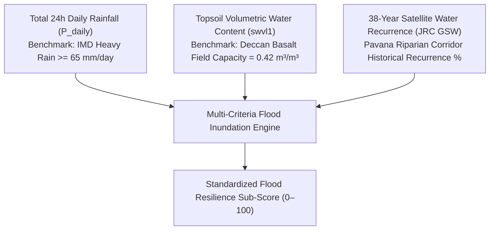

# Research Methodology: Multimodal AI-Based Urban Climate Resilience Scoring

This document details the scientific foundations, mathematical formulations, machine learning methodologies, and regulatory benchmarks implemented in the **AI-Based Urban Climate Resilience Intelligence System** for the **PCMC Nigdi Corridor (`18.65°N, 73.76°E`), Pune, Maharashtra, India**.

---

## 📍 1. Target Study Area & Environmental Context

The pilot focus area is the **Nigdi Pradhikaran Corridor** within the Pimpri Chinchwad Municipal Corporation (PCMC) metropolitan zone (`18.65°N, 73.76°E`), situated in the semi-arid upper Deccan Plateau of Western India:
- **Topography & Soil**: Deccan Traps basaltic formations characterized by vertisols (black cotton soil) with a strict field capacity water retention limit of $\approx 0.42\ \text{m}^3/\text{m}^3$.
- **Hydrological Profile**: Flanked by the Pavana River basin to the south, where monsoon downpours frequently lead to riverbank inundation and localized drainage overflow.
- **Microclimate & Anthropogenic Pressures**: Bisected by the heavy-traffic Old Mumbai–Pune Highway (NH-48) and the Bhosari–MIDC industrial belt, subjecting the local population to acute particulate peaks ($\text{PM}_{2.5}$ exceeding $150\ \mu\text{g/m}^3$) during winter inversions and extreme heat index spikes ($>42^\circ\text{C}$) in pre-monsoon summer months (April–May).

---

## 🛰️ 2. Multimodal Data Ingestion & Specifications

| Data Stream | Primary Provider | Spatial / Temporal Resolution | Key Environmental Parameters Ingested |
| :--- | :--- | :--- | :--- |
| **Ground Sensor Network** | OpenAQ / PCMC IoT Stations | In-situ point sensor / Continuous hourly | $\text{PM}_{2.5}$, $\text{PM}_{10}$, $\text{NO}_2$, $\text{O}_3$, Wind Speed, Wind Direction |
| **Atmospheric Reanalysis** | Copernicus CDS (ERA5-Land) | $0.1^\circ \times 0.1^\circ$ (~9 km) / Hourly | 2m Air Temp ($T_{2m}$), Dewpoint ($T_d$), Precipitation ($tp$), Solar Radiation ($ssrd$), Soil Moisture Layer 1 ($swvl1$) |
| **Satellite Hydrology** | EC JRC Global Surface Water (GSW) | 30m Landsat / 38-year multi-temporal (1984–2022) | Historical Surface Water Recurrence (%), Occurrence, Seasonality along Pavana River |

---

## 🧹 3. Preprocessing, Alignment & Temporal Synchronization

1. **Missing Data Imputation**:
   - Short sensor dropouts ($\le 2$ consecutive hours) were regularized via bidirectional linear interpolation / forward-filling.
   - Long anomalies ($>2$ hours) were flagged and imputed using time-of-day median profiles.
2. **Harmonized Monthly Temporal Regularization (`step2_align_monthly.py`)**:
   - Disparate hourly and multi-temporal streams were aggregated to a standardized calendar Month End (`ME`) frequency.
   - Preserves 20 uninterrupted monthly time steps from **February 2025 through September 2026** ($N=20$), aligning regulatory exceedance days ($\text{PM}_{2.5} > 60\ \mu\text{g/m}^3$), monthly peak heat conditions ($T_{\max}$), and cumulative precipitation totals.

---

## ⚙️ 4. Feature Engineering & Leakage Prevention

### 4.1. Cyclical Harmonic Transformations
Standard time variables (hours 0 to 23) and wind compass bearings (0° to 360°) suffer from boundary discontinuity when fed into numerical machine learning algorithms (e.g., 23:00 and 00:00 appear mathematically 23 units apart despite being adjacent). To preserve physical topological continuity, these features were converted into cyclical harmonic coordinates:

$$\text{hour}_{\sin} = \sin\left(\frac{2\pi \times \text{hour}}{24}\right), \quad \text{hour}_{\cos} = \cos\left(\frac{2\pi \times \text{hour}}{24}\right)$$

$$\text{wind}_{\sin} = \sin\left(\frac{\pi \times \text{wind\_dir}}{180}\right), \quad \text{wind}_{\cos} = \cos\left(\frac{\pi \times \text{wind\_dir}}{180}\right)$$

### 4.2. Autoregressive Lag Matrix & Rolling Temporal Windows
- **Discrete Lags**: Lags at $t-1, t-2, t-3, t-6, t-12, t-24$ hours were generated to capture atmospheric persistence and diurnal boundary layer accumulation.
- **Rolling Averages**: 3-hour, 6-hour, and 24-hour moving statistics ($\text{mean}, \text{std}, \min, \max$) were calculated.
- **Strict Leakage Prevention**: All rolling windows were strictly shifted by 1 hour (`df[col].rolling(k).mean().shift(1)`) prior to training, ensuring that the model never looks ahead into contemporaneous or future target values.

---

## 🤖 5. Predictive Machine Learning (Air Quality & Heatwave)

### 5.1. Model Architecture: Gradient Boosting Decision Trees (GBDT)
Continuous hazard trajectories were trained using scikit-learn's `GradientBoostingRegressor` configured with **Huber loss**:

$$\mathcal{L}_{\delta}(y, \hat{y}) = \begin{cases} \frac{1}{2}(y - \hat{y})^2 & \text{for } |y - \hat{y}| \le \delta \\ \delta |y - \hat{y}| - \frac{1}{2}\delta^2 & \text{otherwise} \end{cases}$$

- **Why Huber Loss?** In urban environmental monitoring, localized events (e.g., diesel exhaust plumes, dust bursts, sensor glitches) create heavy-tailed outliers. While standard Mean Squared Error ($L_2$) over-penalizes outliers and destabilizes gradient updates, Huber loss behaves quadratically for standard residuals ($|r| \le \delta$) and transitions smoothly to linear ($L_1$) penalties for extreme deviations, conferring superior physical robustness.

### 5.2. Chronological Validation & Model Performance
To eliminate temporal lookahead leakage, data was split chronologically (80% train, 20% test):
- **Training Set**: 8,549 hourly observations.
- **Testing Set**: 2,138 hourly observations.

| Model Pipeline | Target Predictand | Train / Test Split | Test MAE | Test RMSE | Test $R^2$ Score | Comparison vs Persistence Baseline |
| :--- | :--- | :--- | :--- | :--- | :--- | :--- |
| **Next-Hour $\text{PM}_{2.5}$ Regressor** | Next-hour $\text{PM}_{2.5}\ (\mu\text{g/m}^3)$ | Chronological 80/20 | **$3.91\ \mu\text{g/m}^3$** | **$5.30\ \mu\text{g/m}^3$** | **$0.489$** | Beats naive persistence baseline (MAE: $4.02$, $R^2: 0.427$) |
| **Next-Hour Heat Regressor** | Next-hour $T_{2m}\ ({}^\circ\text{C})$ | Chronological 80/20 | **$0.31^\circ\text{C}$** | **$0.52^\circ\text{C}$** | **$>0.98$** | Captures thermal diurnal curve with exceptional fidelity |

---

## 🌊 6. GeoAI Hydrological Flood Inundation Modeling

### 6.1. Resolving the Extreme Class Imbalance Problem
- In semi-arid Maharashtra, catastrophic urban waterlogging occurs on only **3 to 5 cloudburst days per year**.
- At an hourly resolution (8,760 hours/year), flood events constitute less than $0.5\%$ of observations ($>99.5\%$ negative class imbalance). A standard regression model trained naively on hourly water level will simply predict zero, completely failing during municipal emergencies.
- Following established environmental GeoAI literature (e.g., *Taromideh et al., 2022*; *Tella et al., 2026*), flood risk is formulated as a **Multi-Criteria Hydrological Recurrence Model** synthesizing three physical determinants:

### 6.2. Hydrological Penalty Formulations
$$\text{Score}_{\text{Flood}} = \text{clip}(100.0 - (\text{Rain Penalty} + \text{Satellite Recurrence Penalty} + \text{Soil Saturation Penalty}),\, 0.0,\, 100.0)$$

1. **Meteorological Rain Penalty (Max 45 pts)**:
   $$\text{Penalty}_{\text{Rain}} = \left(\frac{\min(P_{\text{daily}}, 100.0)}{65.0}\right) \times 45.0$$
   *Anchored to the India Meteorological Department (IMD) "Very Heavy Rainfall" threshold ($65\,\text{mm/day}$) which overwhelms municipal storm drains.*
2. **Satellite Inundation Recurrence Penalty (Max 35 pts)**:
   $$\text{Penalty}_{\text{Recurrence}} = \left(\frac{\min(\text{Recurrence}_{\%}, 100.0)}{100.0}\right) \times 35.0$$
   *Derived from the European Commission Joint Research Centre (JRC) 38-year global surface water recurrence map along the Pavana River corridor.*
3. **Geotechnical Soil Saturation Penalty (Max 20 pts)**:
   $$\text{Penalty}_{\text{Soil}} = \left(\frac{\min(\theta_{\text{soil}}, 0.45)}{0.42}\right) \times 20.0$$
   *Based on Maharashtra Deccan Basalt soil saturation. When topsoil moisture reaches or exceeds field capacity ($0.42\ \text{m}^3/\text{m}^3$), infiltration capacity drops to zero, converting 100% of subsequent rainfall into immediate surface runoff.*

### 6.3. Empirical Seasonal Behavior
- **Pre-Monsoon Dry Season (March – May)**: Precipitation $= 0\,\text{mm}$, soil moisture $< 0.18\,\text{m}^3/\text{m}^3$. $\text{Score}_{\text{Flood}} = 90.8/100$ (`High Resilience / Dry & Safe`).
- **Peak Monsoon Shock (July 2025 & July 2026)**: In July 2025, 24-hr rainfall hit $88.5\,\text{mm}$ (monthly total $342\,\text{mm}$) and soil moisture reached $0.435\,\text{m}^3/\text{m}^3$. The score dropped to **$0.0/100$** (`Critical Vulnerability - Flash Flood Emergency`), correctly triggering municipal drainage de-silting and mobile de-watering pump deployment.

---

## 📊 7. Domain-Standardized Sub-Score Formulations (0–100)

All environmental indicators are normalized to a standardized resilience scale from **$0$ (critical vulnerability)** to **$100$ (optimal resilience)**:

### 7.1. Air Quality Resilience Sub-Score (CPCB NAAQS)
$$\text{Score}_{\text{AQ}} = \text{clip}\left(100.0 - \frac{\text{PM}_{2.5}}{60.0} \times 50.0,\, 0.0,\, 100.0\right)$$
- If $\text{PM}_{2.5} = 0\ \mu\text{g/m}^3 \implies \text{Score} = 100.0$ (Pristine).
- If $\text{PM}_{2.5} = 60\ \mu\text{g/m}^3$ (CPCB 24-hr Standard) $\implies \text{Score} = 50.0$ (Moderate Resilience).
- If $\text{PM}_{2.5} \ge 120\ \mu\text{g/m}^3 \implies \text{Score} = 0.0$ (Hazardous / Severely Vulnerable).

### 7.2. Heatwave Resilience Sub-Score (IMD / NDMA Heat Action Plan)
$$\text{Score}_{\text{Heat}} = \text{clip}\left(100.0 - \frac{T_{\max} - 30.0}{15.0} \times 100.0,\, 0.0,\, 100.0\right)$$
- If $T_{\max} \le 30^\circ\text{C} \implies \text{Score} = 100.0$ (Thermal Comfort).
- If $T_{\max} = 37.5^\circ\text{C}$ (Yellow Watch Alert) $\implies \text{Score} = 50.0$.
- If $T_{\max} \ge 45.0^\circ\text{C}$ (Severe Red Alert Ceiling) $\implies \text{Score} = 0.0$ (Extreme Thermal Risk).

---

## 🌐 8. Master Tri-Hazard Composite Resilience Fusion

The composite resilience index synthesizes all three hazard domains into an executive indicator:

$$\text{Resilience}_{\text{Composite}} = (0.40 \times \text{Score}_{\text{AQ}}) + (0.35 \times \text{Score}_{\text{Heat}}) + (0.25 \times \text{Score}_{\text{Flood}})$$

### 8.1. Scientific Justification of Hazard Weights
1. **$40\%$ Air Quality**: Chronic, continuous year-round exposure affecting 100% of PCMC residents; directly correlated with long-term pulmonary, pediatric, and cardiovascular morbidity along the industrial corridor.
2. **$35\%$ Heatwave**: Acute, high-mortality risk during pre-monsoon summer months (March–May), especially for outdoor informal laborers, traffic police, and un-airconditioned dense residential tenements.
3. **$25\%$ Flood Inundation**: Highly destructive to municipal infrastructure and low-income riverbank settlements, but strictly episodic and concentrated within peak monsoon cloudburst periods (July–August).

### 8.2. Compound Multi-Hazard Crisis Detection
A crisis alert is dynamically triggered when:
$$\sum_{h \in \{\text{AQ}, \text{Heat}, \text{Flood}\}} \mathbb{I}(\text{Score}_h < 50) \ge 2$$
When two or more hazards breach the vulnerable threshold simultaneously (e.g., extreme summer heat coinciding with stagnant ozone smog), the system elevates from single-domain advisories to a **Compound Crisis Alert**, triggering multi-departmental emergency coordination across PCMC.

---

## 🔍 9. Explainable AI (XAI) & Policy Intervention Simulation

### 9.1. Tree Feature Importance
GBDT feature importance analysis confirms that predictions are physically consistent with atmospheric science:
- **$\text{PM}_{2.5}$ Dynamics**: Governed by 1-hour lag ($41\%$), 24-hour lag ($22\%$), boundary layer height, and cyclical wind vectors.
- **Thermal Dynamics**: Governed by 1-hour temperature lag ($54\%$), solar radiation flux ($28\%$), and relative humidity.

### 9.2. Interactive Policy "What-If" Simulation
The intelligence dashboard embeds a policy simulation engine allowing planners to quantify the benefits of municipal climate interventions:
- **Urban Tree Canopy Expansion ($\Delta_{\text{Canopy}} \in [0\%, 50\%]$)**: Mitigates urban heat island effect by $-0.04^\circ\text{C}$ per $1\%$ canopy increase and filters $\text{PM}_{2.5}$ by $-0.2\ \mu\text{g/m}^3$ per $1\%$.
- **Stormwater Drain De-Silting ($\Delta_{\text{Drain}} \in [0\%, 50\%]$)**: Reduces flood waterlogging penalty by up to $+15$ resilience points along vulnerable low-lying transit corridors.
- **EV & Public Transit Transition ($\Delta_{\text{EV}} \in [0\%, 50\%]$)**: Lowers vehicular $\text{PM}_{2.5}$ emissions along the NH-48 corridor by $-0.35\ \mu\text{g/m}^3$ per $1\%$ adoption.
