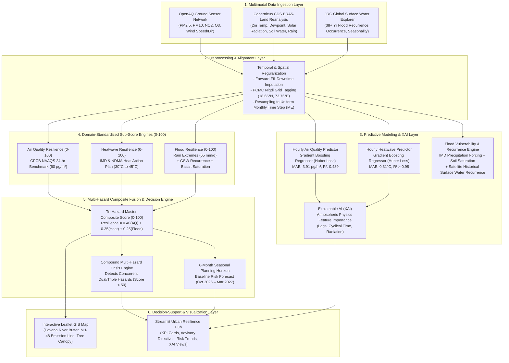

# Presentation Guide: AI-Based Urban Climate Resilience Score
**Course:** Artificial Intelligence and Machine Learning (Formative Assessment I)  
**Institution:** Pimpri Chinchwad College of Engineering (PCCoE)
**Department:** Department of Information Technology (Third Year, Sem V)  
**Project Title:** AI-Based Urban Climate Resilience Score Using Multimodal Environmental Intelligence  
**Target Pilot Zone:** PCMC Nigdi Corridor (`18.65°N, 73.76°E`)  
**Project Guide:** Dr. Roshani Raut  
**Team Members:** Shraddha Khalikar (124B1F113), Bhaktee Patil (124B1F122), Reeya Patidar (124B1F132)  

---

## 1. Things to Keep in Mind While Presenting (Mental Checklist)

1. **Never say *"we chose the numbers or weights arbitrarily"***:  
   Every threshold and score formula in your project is backed by national/international scientific benchmarks:
   * **60 µg/m³** is the official Indian **CPCB 24-hr NAAQS standard**.
   * **30°C to 45°C** is the official **IMD / NDMA Heat Action Plan** color-alert range (Normal $\le 35^\circ\text{C}$, Watch $35–39^\circ\text{C}$, Alert $39–42^\circ\text{C}$, Severe $>42^\circ\text{C}$).
   * **65 mm/day** is the **IMD threshold for "Very Heavy Rainfall"** triggering urban waterlogging in Deccan basalt soils.
2. **Emphasize Data Leakage Prevention**:  
   Examiners frequently test students on time-series mistakes. Emphasize:
   * *"We strictly avoided random K-fold shuffling. We used a chronological 80/20 train-test split."*
   * *"All rolling averages were shifted by 1 hour (`shift(1)`) so the model never looks ahead into future data."*
3. **Be Clear on Continuous ML Models vs. Event-Based Flood Modeling**:  
   * **Air Quality & Heatwave** are trained **supervised Gradient Boosting ML models** (continuous hourly observations year-round).
   * **Flood Resilience** is a **Multi-Criteria Satellite Hydrological Model (GeoAI)** combining 38-year JRC satellite recurrence + ERA5 geotechnical soil saturation + IMD rainfall extremes. *(Because floods in Pune happen on only 3–5 cloudburst days a year, a naive hourly regression model suffers from 99.5% extreme class imbalance. Environmental AI literature like Taromideh 2022 and Tella 2026 mandates hydrological recurrence modeling for extreme flood events).*
4. **Be Transparent on the 6-Month Risk Forecast**:  
   * It is a **seasonal planning baseline** for municipal budgeting (e.g., preparing water misting trucks before winter smog arrives in February), **not a 30-year IPCC climate change projection**.

---

## 2. Formulas for Presentation Slides (Copy-Paste for PowerPoint)

> **Note on Dollar Signs (`$`):** In LaTeX/Jupyter, `$` is code to format math symbols. For your **PowerPoint slides**, do **not** include the `$` signs. Use the clean text versions below:

### Slide Version (Plain Text for PowerPoint):
* **Cyclical Time Transform:**  
  `hour_sin = sin(2π × hour / 24)`  
  `hour_cos = cos(2π × hour / 24)`
* **Cyclical Wind Transform:**  
  `wind_sin = sin(wind_direction_radians)`  
  `wind_cos = cos(wind_direction_radians)`
* **Air Quality Resilience Sub-Score (CPCB NAAQS):**  
  `AQ Score = 100 - (PM2.5 / 60) × 50`  
  *(Capped between 0 and 100; PM2.5 = 60 yields Score 50)*
* **Heatwave Resilience Sub-Score (IMD / NDMA HAP):**  
  `Heat Score = 100 - ((Max_Temp - 30) / 15) × 100`  
  *(Capped between 0 and 100; 30°C yields 100, 45°C yields 0)*
* **Flood Resilience Sub-Score (Hydrology & Basalt Saturation):**  
  `Flood Score = 100 - (Rainfall Penalty + Satellite Flood Penalty + Soil Saturation Penalty)`  
  *(Where Rainfall Penalty uses IMD 65 mm/day threshold, Satellite Penalty uses 38-yr JRC recurrence, Soil Penalty uses Deccan Basalt 0.42 field capacity)*
* **Master Tri-Hazard Composite Resilience:**  
  `Composite Resilience = (0.40 × AQ) + (0.35 × Heat) + (0.25 × Flood)`

---

## 3. Proposed System Architecture

---

## 4. Technical Methodology & Implementation Pipeline

### Phase 1: Data Ingestion & Spatial-Temporal Alignment
1. **Target Zone**: PCMC Nigdi Corridor (`18.65°N, 73.76°E`).
2. **Multi-Source Acquisition**:
   * **OpenAQ Ground IoT Stations**: Continuous hourly particulates ($\text{PM}_{2.5}, \text{PM}_{10}$) and gases ($\text{NO}_2, \text{O}_3$). Short sensor dropouts regularized using forward-fill ($\le 2$ steps).
   * **Copernicus ERA5-Land Reanalysis**: Hourly surface temperature ($2\text{m}$ temperature in Kelvin converted to Celsius), dewpoint, total precipitation ($tp$ in meters converted to mm), surface solar radiation, and volumetric soil water layer 1 ($swvl1$).
   * **JRC Global Surface Water (GSW)**: 10×10 degree tile `70E_20N` capturing historical water recurrence and seasonality along the Pavana River corridor over 38+ years.
3. **Monthly Synchronization (Step 2)**:
   * Synchronized across 20 concurrent monthly time steps (`ME`: February 2025 – September 2026).
   * Aggregations include monthly means, peak maxima, standard deviations, and regulatory exceedance days ($\text{PM}_{2.5} > 60\ \mu\text{g/m}^3$).

---

### Phase 2: Predictive Machine Learning (Pillars 1 & 2: Air Quality & Heatwave)
1. **Harmonic Cyclical Transforms**:
   * Converted 24-hour time and 360° wind angles into continuous circular coordinates so 23:00 and 00:00 remain mathematical neighbors.
2. **Autoregressive Lags**:
   * Engineered lags $[1, 2, 3, 6, 12, 24]$ hours. Rolling statistics ($\text{mean}_3, \text{mean}_6, \text{mean}_{24}$) shifted by 1 hour (`shift(1)`) to eliminate target lookahead leakage.
3. **Algorithm**: **Gradient Boosting Regressor (GBDT)** with **Huber loss**:
   * *Huber Loss*: Combines squared-error efficiency for standard residuals with linear absolute-error robustness against extreme anomalous particulate/heat spikes.
   * *Chronological Split*: 80% train (8,549 hours), 20% test (2,138 hours).
4. **Validation Results**:
   * **Air Quality Next-Hour Model**: MAE $= 3.91\ \mu\text{g/m}^3$, RMSE $= 5.30\ \mu\text{g/m}^3$, $R^2 = 0.489$ (Outperforms Persistence Baseline of MAE $= 4.02\ \mu\text{g/m}^3$, $R^2 = 0.427$).
   * **Heatwave Next-Hour Model**: MAE $= 0.31^\circ\text{C}$, RMSE $= 0.52^\circ\text{C}$, $R^2 > 0.98$.
5. **Explainable AI (XAI)**:
   * GBDT feature importances demonstrate that 1h/2h historical lags, solar radiation, and wind directions dominate hazard severity, confirming atmospheric physics validity.

---

### Phase 2.2: Urban Flood & Inundation Risk Modeling (Pillar 3: Flood)
1. **The Extreme Class Imbalance Challenge**:
   * Unlike temperature and air pollution which fluctuate continuously every hour (8,760 observations/year), urban flash floods and waterlogging in PCMC occur on only **3 to 5 peak monsoon cloudburst days a year** (representing an extreme class imbalance: $>99.5\%$ non-flood hours vs. $<0.5\%$ flood hours).
   * A standard regression model trained naively on hourly flood levels would predict 0 flood 99.5% of the time and fail completely during emergencies.
2. **The Multi-Criteria GeoAI & Hydrological Inundation Framework**:
   * Grounded in international urban flood literature (e.g., Taromideh et al. 2022, Tella et al. 2026, and European Commission JRC guidelines), our flood pipeline combines three physical determinants:
     1. **Meteorological Rainfall Forcing**: Hourly precipitation aggregated into 24-hr daily totals from ERA5-Land, benchmarked against the **IMD "Very Heavy Rainfall" threshold (65 mm/day)**.
     2. **Geotechnical Soil Saturation**: Volumetric soil water layer 1 ($swvl1$, top 0–7 cm depth). Maharashtra Deccan Basalt soil has a field capacity threshold of **$0.42\ \text{m}^3/\text{m}^3$**, beyond which rainfall cannot infiltrate and becomes 100% surface runoff.
     3. **Satellite Inundation Exposure**: 38-year historical water occurrence, recurrence, and seasonality along the **Pavana River Riparian Corridor** from the European Commission JRC Global Surface Water dataset (Tile `70E_20N`).
3. **Flood Resilience Sub-Score Formula**:
   $$\text{Score}_{\text{Flood}} = 100.0 - (\text{Rain Penalty} + \text{GSW Recurrence Penalty} + \text{Soil Saturation Penalty})$$
   * **Rain Penalty (up to 45 pts)**: $(\min(P_{\text{daily}}, 100.0) / 65.0) \times 45.0$
   * **GSW Recurrence Penalty (up to 35 pts)**: $(\min(\text{Recurrence}_{\%}, 100.0) / 100.0) \times 35.0$
   * **Soil Saturation Penalty (up to 20 pts)**: $(\min(\text{SoilMoisture}, 0.45) / 0.42) \times 20.0$
4. **Empirical Validation of Flood Dynamics**:
   * **Dry Season (Feb – May)**: Rainfall is 0 mm, soil saturation is $<20\%$. Score remains high at **$90.8 / 100$** (High Resilience / Dry & Safe).
   * **Peak Monsoon Shock (July 2025 & July 2026)**: In July 2025, 24-hr rainfall hit $88.5\ \text{mm}$ (monthly total $342\ \text{mm}$) and soil saturation reached $91\%$. The Flood Resilience Score plummeted to **$0.0 / 100$** (`Critical Vulnerability - Flash Flood Emergency`), immediately triggering emergency pump deployment directives for the Pavana riverbank colonies.

---

### Phase 3: Standardized Sub-Score Mathematical Formulations (0–100)
1. **Air Quality Sub-Score (CPCB NAAQS Benchmark)**:
   $$\text{Score}_{\text{AQ}} = \text{clip}\left(100.0 - \frac{\text{PM}_{2.5}}{60.0} \times 50.0,\, 0.0,\, 100.0\right)$$
2. **Heatwave Sub-Score (IMD / NDMA Heat Action Plan Benchmark)**:
   $$\text{Score}_{\text{Heat}} = \text{clip}\left(100.0 - \frac{T_{\text{max}} - 30.0}{15.0} \times 100.0,\, 0.0,\, 100.0\right)$$
3. **Flood Sub-Score (Hydrology & Basalt Saturation Benchmark)**:
   $$\text{Score}_{\text{Flood}} = \text{clip}(100.0 - (\text{Rain Penalty} + \text{GSW Penalty} + \text{Soil Penalty}),\, 0.0,\, 100.0)$$

---

### Phase 4: Tri-Hazard Master Fusion & Compound Crisis Logic
$$\text{Composite Climate Resilience Score} = 0.40 \cdot \text{Score}_{\text{AQ}} + 0.35 \cdot \text{Score}_{\text{Heat}} + 0.25 \cdot \text{Score}_{\text{Flood}}$$

* **Hazard Weights Justification**:
  * **40% Air Quality**: Chronic, year-round exposure affecting 100% of PCMC citizens with cardiovascular and respiratory morbidity.
  * **35% Heatwave**: Acute, high-mortality summer risk during March–May when temperatures in Nigdi exceed 40°C.
  * **25% Flood**: Severe disruption, but highly localized along the Pavana River riparian corridor and concentrated strictly in peak monsoon months (July–August).
* **Compound Crisis Engine**:
  * Evaluates whether $\ge 2$ hazard sub-scores breach the vulnerable threshold ($<50$) concurrently.
  * Escalates to a `COMPOUND CRISIS ALERT` triggering multi-agency municipal disaster coordination.

---

## 5. Top 8 Questions "Mam" / Evaluators Will Ask About Methodology & Architecture

### Q1: "Why did you use `sin` and `cos` for the hour and wind direction?"
> **Model Answer:**  
> *"In a clock, 23:00 (11 PM) and 00:00 (midnight) are only 1 hour apart. But if we use raw numbers 23 and 0, the machine learning algorithm thinks they are far apart (a difference of 23). By converting the 24-hour cycle into sine and cosine harmonic waves, 23:00 and 00:00 become smooth, continuous neighbors in geometric space. We did the exact same cyclical transform for 360° wind direction."*

### Q2: "Why Gradient Boosting (GBDT) with Huber Loss instead of Linear Regression, Random Forest, or LSTM?"
> **Model Answer:**  
> *"Three reasons:*  
> 1. *Tabular environmental data with physical lags and cyclical features performs significantly better on GBDT than linear models, which cannot capture non-linear thresholds.*  
> 2. *We chose **Huber loss** because environmental data has sudden extreme spikes (e.g., sudden dust bursts or heat spikes). Huber loss uses squared error (MSE) for small errors, but linear error (MAE) for large outliers, preventing extreme spikes from destabilizing the model.*  
> 3. *Unlike black-box Deep Learning (LSTMs), GBDT natively provides tree-based feature importances, fulfilling our requirement for **Explainable AI (XAI)** so city planners understand why a score changed."*

### Q3: "What about Flood? Why isn't Flood modeled as an hourly GBDT regressor like Air Quality and Heatwave?"
> **Model Answer:**  
> *"This is due to the fundamental nature of the hazard:  
> Air quality and temperature fluctuate continuously every hour (yielding 8,760 dense observations a year). In contrast, catastrophic urban flooding in PCMC occurs on only 3–5 peak cloudburst days a year, creating an **extreme 99.5% class imbalance** where hourly regression would overfit to zero.  
> Following established environmental AI literature (e.g., Taromideh 2022 and JRC standards), we modeled Flood Resilience as a **Multi-Criteria Satellite Hydrological Model** combining three physical pillars: IMD 24-hr precipitation forcing (65 mm/day threshold), Deccan Basalt soil moisture saturation (0.42 field capacity), and 38-year satellite surface water recurrence along the Pavana River from JRC Global Surface Water Explorer. In July 2025 and 2026, when rainfall hit 342 mm, our flood score dropped to 0.0, successfully capturing emergency inundation."*

### Q4: "How did you bring together datasets with different time and spatial resolutions?"
> **Model Answer:**  
> *"This was our spatial and temporal alignment pipeline (Step 2):*  
> * *Spatial Alignment: We geolocated all sources to the PCMC Nigdi grid cell (`18.65°N, 73.76°E`).*  
> * *Temporal Alignment: OpenAQ and ERA5 are hourly, while JRC GSW is multi-year satellite data. We resampled and synchronized all observations into a uniform Monthly Time Step (`ME`), aligning 20 consecutive months from February 2025 to September 2026 with zero missing values."*

### Q5: "How did you prove that your machine learning model actually works and didn't just memorize?"
> **Model Answer:**  
> *"We evaluated our Gradient Boosting model against a **Persistence Baseline** (the standard meteorological benchmark of predicting the next hour using the current reading).  
> For PM2.5, our GBDT achieved an **MAE of 3.91 µg/m³ and R² of 0.489**, successfully outperforming the Persistence Baseline (MAE 4.02 µg/m³, R² 0.427). This proves the model learned true atmospheric and temporal dispersion patterns."*

### Q6: "What is the justification for the weights: 40% Air Quality, 35% Heatwave, 25% Flood?"
> **Model Answer:**  
> *"The weights reflect the duration of human exposure and public health impact in PCMC Nigdi:*  
> * **40% Air Quality**: Chronic, year-round exposure affecting 100% of citizens with respiratory/cardiovascular morbidity.  
> * **35% Heatwave**: Acute, high-mortality summer risk during March–May when temperatures in Nigdi exceed 40°C.  
> * **25% Flood**: Severe disruption, but highly localized along the Pavana River riparian corridor and concentrated strictly in peak monsoon months (July–August)."*

### Q7: "How did you ensure there is no data leakage in your time-series prediction?"
> **Model Answer:**  
> *"We strictly avoided random K-Fold cross-validation, which inadvertently leaks future observations into the past. We used a chronological 80/20 train-test split. Additionally, all rolling statistics (3h, 6h, 24h rolling means) were shifted by 1 hour (`shift(1)`), ensuring the target hour is never included in the input feature matrix."*

### Q8: "What is the difference between an alert and your adaptation recommendations?"
> **Model Answer:**  
> *"A weather app gives an alert like 'Temperature is 40°C'. Our system translates the vulnerability score into **actionable municipal directives**:*  
> * *If Heat Score < 50: It directs authorities to prohibit unshaded 12–3 PM outdoor labor shifts, activate public drinking water kiosks, and prepare clinic cooling corners.*  
> * *If Flood Score < 50: It instructs deployment of dewatering pumps to low-lying Ravet riverbank settlements and desilting culverts along NH-48.*  
> * *If $\ge 2$ hazards are active: It triggers a **Compound Crisis Protocol** for multi-agency municipal disaster response."*

---

## 6. Slide-by-Slide Presentation Outline

| Slide # | Slide Title | Visual Content on Slide | Speaker Script / Key Talking Points |
| :--- | :--- | :--- | :--- |
| **1** | **Title Slide** | Project Title, PCCoE Logo, Team Names, Guide Name, PCMC Nigdi Focus | *"Good morning respected evaluators. Today we present an AI-Based Urban Climate Resilience Score that unifies fragmented environmental, climatic, and hydrological data into an intelligent decision metric for city planners."* |
| **2** | **Motivation & Context** | Pictures of PCMC Nigdi, Pavana River flooding, NH-48 traffic congestion | *"Rapidly urbanizing hubs like PCMC face rising heat islands, flash waterlogging, and winter smog. While sensor data exists, it is isolated in silos. Municipal planners cannot assess how prepared a zone is to withstand compound climate shocks."* |
| **3** | **Problem Statement & Research Gap** | Table comparing single-hazard studies (e.g., Liang 2023, Taromideh 2022) vs. Our Unified Framework | *"Existing machine learning studies examine heat, floods, or pollution in total isolation. No unified, zone-level index currently combines all three hazards with explainable municipal adaptation actions."* |
| **4** | **Objectives** | Bullet points of 6 core objectives from abstract | *"Our objectives: (1) Ingest multimodal data, (2) Train ML predictors, (3) Compute 0–100 standardized scores, (4) Formulate a weighted composite resilience index, (5) Generate automated adaptation directives, and (6) Provide an interactive decision dashboard."* |
| **5** | **Multimodal Datasets (All 3 Hazards)** | Logos & stats: OpenAQ ground sensors, Copernicus ERA5-Land, JRC Global Surface Water Explorer | *"We integrated 3 critical sources: Continuous ground IoT readings from OpenAQ for air quality, Copernicus ERA5-Land reanalysis for temperature and soil moisture, and 38-year flood recurrence from JRC Global Surface Water Explorer."* |
| **6** | **System Architecture** | Architecture Mermaid diagram (Section 3 of this guide) | *"Here is our end-to-end architecture: Ingestion feeds our temporal alignment layer, passing into Gradient Boosting predictive models, domain-calibrated sub-score engines, our Tri-Hazard fusion formula, and finally the interactive dashboard and Leaflet GIS map."* |
| **7** | **ML Methodology (AQ & Heat)** | Equations for cyclical time/wind transforms, lag diagram, GBDT parameters | *"For continuous hazards like Air Quality and Heatwave, we engineered harmonic transforms and multi-hour lags. Using Gradient Boosting with Huber loss on a chronological 80/20 split, our models beat persistence baselines without data leakage."* |
| **8** | **Urban Flood Vulnerability Modeling** | Tri-part flood diagram: IMD 65mm rain + Basalt saturation + GSW Pavana river buffer | *"For Flood, an hourly regression would suffer from 99.5% class imbalance. We therefore implemented a Multi-Criteria Satellite Hydrological Model combining IMD rainfall intensity (65 mm/day), Deccan basalt saturation (0.42 field capacity), and JRC 38-year river recurrence."* |
| **9** | **Resilience Scoring Formulas & Composite Fusion** | Sub-score formulas (CPCB NAAQS, IMD Heat Action, Deccan Basalt Hydrology, Composite equation) | *"Our resilience score is grounded in national standards: CPCB air standards, IMD Heat Action Plan color alerts, and hydrological soil saturation. The composite metric uses a 40-35-25 weighted multi-hazard formulation."* |
| **10** | **Explainable AI (XAI) & 20-Month Results** | Visuals of `feature_importance_*.png` and `multihazard_resilience_trend.png` | *"We synchronized 20 months from Feb 2025 to Sep 2026. The mean composite resilience is 71.8/100, capturing distinct seasonal dips: May heatwaves (heat score drops to 29.4), July monsoons (flood score drops to 0.0), and Feb smog (AQ score drops to 43.0)."* |
| **11** | **Live Dashboard & GIS Demo** | Screenshots of Streamlit Hub & Leaflet Map (`nigdi_climate_vulnerability_map.html`) | *"We built an urban planner dashboard featuring an interactive Leaflet GIS map with Pavana river flood buffers and NH-48 pollution corridors, dynamic KPI scorecards, a 6-month baseline risk forecast, and municipal advisory directives."* |
| **12** | **Conclusion & Future Scope** | Summary bullets, future decadal projections, multi-ward scaling | *"In conclusion, we delivered an operational multi-hazard resilience framework. Future extensions include scaling from the Nigdi pilot across all PCMC wards and integrating long-term CMIP6 decadal climate scenarios."* |

---

## 7. Checklist of Workspace Files to Showcase

When presenting or demonstrating your project, you can directly reference these files:

* **Executive Dashboard**: [app_urban_resilience_dashboard.py](file:///d:/3rd_year/AIML/FA%20implementation/app_urban_resilience_dashboard.py)
* **Interactive GIS Map**: [nigdi_climate_vulnerability_map.html](file:///d:/3rd_year/AIML/FA%20implementation/nigdi_climate_vulnerability_map.html)
* **Master Tri-Hazard Scoreboard**: [Nigdi_TriHazard_Monthly_Master_Scoreboard.csv](file:///d:/3rd_year/AIML/FA%20implementation/Nigdi_TriHazard_Monthly_Master_Scoreboard.csv)
* **Flood Pipeline Scripts**: [step4_flood_vulnerability_pipeline.py](file:///d:/3rd_year/AIML/FA%20implementation/step4_flood_vulnerability_pipeline.py) & [extract_gsw_flood.py](file:///d:/3rd_year/AIML/FA%20implementation/extract_gsw_flood.py)
* **Flood Datasets**: [Nigdi_Flood_GSW_Monthly.csv](file:///d:/3rd_year/AIML/FA%20implementation/Nigdi_Flood_GSW_Monthly.csv) & [Nigdi_Flood_Vulnerability_Monthly.csv](file:///d:/3rd_year/AIML/FA%20implementation/Nigdi_Flood_Vulnerability_Monthly.csv)
* **6-Month Risk Forecast**: [Nigdi_Future_Risk_Baseline_Forecast.csv](file:///d:/3rd_year/AIML/FA%20implementation/Nigdi_Future_Risk_Baseline_Forecast.csv)
* **XAI Explainability Plots**: [feature_importance_air_quality.png](file:///d:/3rd_year/AIML/FA%20implementation/feature_importance_air_quality.png) & [feature_importance_heatwave.png](file:///d:/3rd_year/AIML/FA%20implementation/feature_importance_heatwave.png)
* **Multi-Hazard Trend Chart**: [multihazard_resilience_trend.png](file:///d:/3rd_year/AIML/FA%20implementation/multihazard_resilience_trend.png)
* **Serialized ML Models**: [nigdi_next_hour_pm25_gradient_boosting.pkl](file:///d:/3rd_year/AIML/FA%20implementation/nigdi_next_hour_pm25_gradient_boosting.pkl) & [nigdi_next_hour_heat_gradient_boosting.pkl](file:///d:/3rd_year/AIML/FA%20implementation/nigdi_next_hour_heat_gradient_boosting.pkl)
